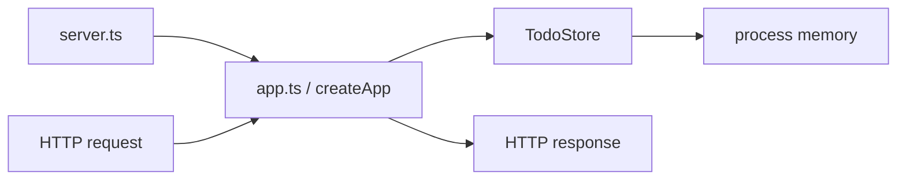

# Backendアーキテクチャ

## モジュール責務

| モジュール      | 責務                                                     |
| --------------- | -------------------------------------------------------- |
| `server.ts`     | `.env`読込み、`PORT`解決、HTTP待受開始                   |
| `app.ts`        | middleware、ルーティング、入力検証、HTTP応答、エラー処理 |
| `todo-store.ts` | Todoの一覧、作成、完了更新、削除をメモリ上で実行         |
| `types.ts`      | `Todo`と共通APIエラー形式の型                            |

`createApp`は待受開始から分離され、テストから新しいストアを持つアプリを生成できます。TodoStoreは値のコピーを返し、外側から内部配列や要素を直接変更させません。

## 設定

| 変数          | 既定値                  | 用途                     |
| ------------- | ----------------------- | ------------------------ |
| `PORT`        | `3001`                  | HTTP待受ポート           |
| `CORS_ORIGIN` | `http://localhost:5173` | 許可するFrontendオリジン |

## 制約と変更条件

- 保存は単一プロセスのメモリ内に限定され、再起動、複数プロセス、水平分割へ対応しません。
- 認証、監査ログ、レート制御、永続DBはありません。
- DBを導入する場合は、保存インターフェース、移行、起動失敗時の扱い、テスト分離を設計し、横断ADRを作成します。
- 共通エラーハンドラーは予期しないエラーをログ出力して500へ正規化します。機密情報を応答へ含めません。
