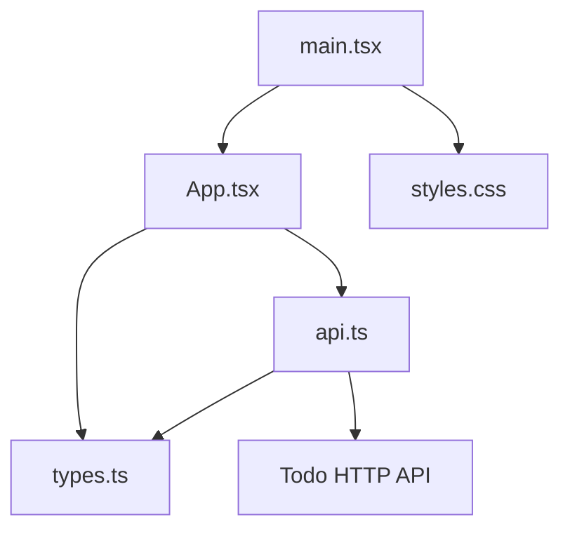
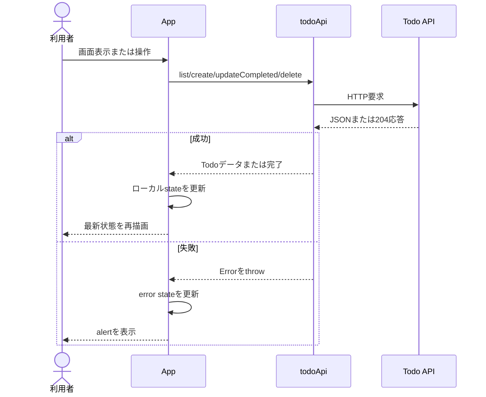

# Frontendアーキテクチャ

## 目的

Frontendのモジュールごとの責務、依存方向、状態管理、Todo操作時のデータフローを定義します。

## 対象範囲

`apps/frontend/src`以下の実行時コードを対象とします。ビルドとテストの責務は[テスト戦略](testing-strategy.md)、Backendとの境界は[API連携仕様](api-integration.md)を参照してください。

## 現行仕様

### モジュールの責務

| モジュール      | 責務                                                                         |
| --------------- | ---------------------------------------------------------------------------- |
| `main.tsx`      | DOMの`#root`へReactアプリをマウントし、Strict ModeとグローバルCSSを適用する  |
| `App.tsx`       | 画面描画、フォーム処理、TodoとUI状態の保持、API呼び出し結果の反映を担う      |
| `api.ts`        | APIベースURLの解決、HTTP要求、応答JSONの変換、エラーメッセージの正規化を担う |
| `types.ts`      | Frontend内で使用する`Todo`と`ApiErrorBody`を定義する                         |
| `styles.css`    | 画面全体、Todoカード、各状態、レスポンシブ表示のスタイルを定義する           |
| `vite-env.d.ts` | Viteの型定義を読み込む                                                       |

### 依存方向

- UIは`todoApi`を介してのみBackendへアクセスします。
- `api.ts`はUIコンポーネントへ依存しません。
- `types.ts`は他のFrontendモジュールへ依存しません。
- CSSは`main.tsx`から1回だけ読み込み、クラス名で`App.tsx`の要素へ適用します。

### 状態管理

`App`は次のローカルstateを保持します。

| state     | 型               | 初期値  | 用途                         |
| --------- | ---------------- | ------- | ---------------------------- |
| `todos`   | `Todo[]`         | `[]`    | 表示対象のTodo一覧           |
| `title`   | `string`         | `''`    | 追加フォームの制御値         |
| `loading` | `boolean`        | `true`  | 初期一覧取得中かどうか       |
| `saving`  | `boolean`        | `false` | Todo追加中かどうか           |
| `error`   | `string \| null` | `null`  | 利用者へ表示する直近のエラー |

派生値である完了件数はstateとして保持せず、レンダー時に`todos`から計算します。グローバル状態管理、Context、キャッシュライブラリは使用しません。

### データフロー

一覧の変更はすべてサーバー成功後に反映します。Frontend側の先行更新やロールバック処理はありません。

### コンポーネント分割方針

現行画面は単一機能であり、状態と操作の関係が小さいため`App`に集約されています。見た目だけを理由に細かいコンポーネントへ分割せず、責務の独立性、再利用性、個別テストの必要性が生じた時点で分割します。

## 分割を検討する条件

次のいずれかが生じた場合に構成を再検討します。

- Todo以外の画面やルーティングを追加する。
- Todoの編集、絞り込み、ページングなどにより状態遷移が増える。
- 複数画面でTodoデータや通信キャッシュを共有する。
- API呼び出しの再試行、キャンセル、キャッシュ、競合制御が必要になる。
- UI部品を複数箇所で再利用する、または独立してテストする必要が生じる。
- スタイルのトークン化やテーマ切り替えが必要になる。

重要な構成変更は実装前に[ADR](adr/README.md)へ記録します。

## 改善候補

- 通信状態とTodo状態を扱うカスタムHookを導入する。
- APIの実行時レスポンス検証を追加する。
- 機能拡大時に画面、機能、共通UIの境界を設ける。
- FrontendとBackendの型生成または契約検証を導入する。

これらは現在の規模では必須とせず、上記の分割条件に達した場合に判断します。

## 関連実装

- `apps/frontend/src/main.tsx`
- `apps/frontend/src/App.tsx`
- `apps/frontend/src/api.ts`
- `apps/frontend/src/types.ts`
- `apps/frontend/src/styles.css`
