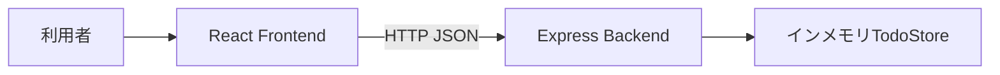

# アーキテクチャ

## システム境界

FrontendとBackendは独立したnpm workspaceです。FrontendはHTTP以外の方法でBackend内部へ依存せず、BackendはFrontendの実装へ依存しません。TodoStoreはプロセス内にあり、Backend再起動でデータは失われます。

## 技術構成

| 領域               | 技術                               | 責務                            |
| ------------------ | ---------------------------------- | ------------------------------- |
| Frontend           | React 19、TypeScript、Vite         | 画面、入力、通信状態、API呼出し |
| Backend            | Express、TypeScript                | HTTP境界、入力検証、Todo操作    |
| Component/API test | Vitest、Testing Library、Supertest | アプリ単位の公開動作            |
| E2E                | Playwright                         | ブラウザーを通した主要導線      |
| 開発環境           | npm workspaces、Docker Compose     | 一貫した起動・検証入口          |

## 依存方向

- Frontend: `main.tsx` → `App.tsx` → `api.ts` → HTTP API。
- Backend: `server.ts` → `app.ts` → `todo-store.ts`。
- 各アプリの型はローカルに所有し、API文書を契約の正本として同期します。
- E2Eは公開URLだけを利用し、アプリ内部モジュールをimportしません。

詳細は`apps/frontend/docs/architecture.md`と`apps/backend/docs/architecture.md`を参照します。重要な技術選択、境界、依存方向を変える場合は`adr/`へ判断を記録します。
